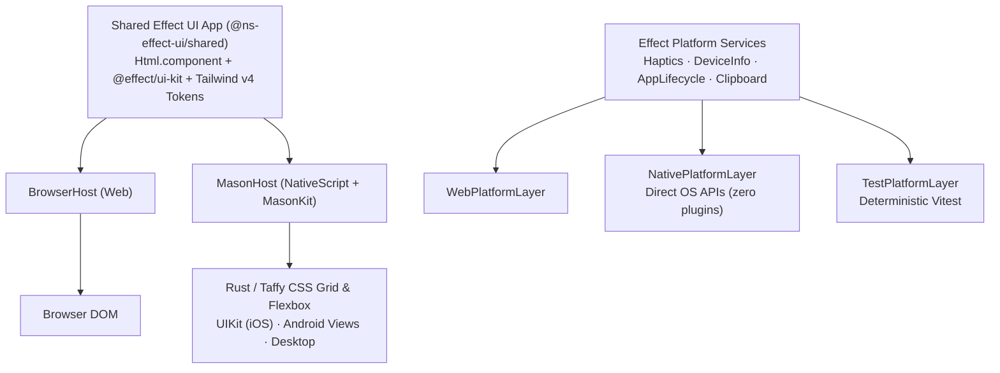

# `@nativescript/effect-ui`

First-class **NativeScript 9.1** & **MasonKit** rendering hosts, native element vocabulary, and platform Effect `Layer`s for **[Effect UI](https://github.com/Effect-TS/ui)** (`@effect/ui`).

Write **one** Effect UI application — with typed `Schema` models, pure `update` transitions, `Query.Service` data fetching, `Command.Service` side effects, `@effect/ui-kit` headless components, and shared Tailwind v4 styling — and run it across **Web (`BrowserHost`)** and **native iOS & Android (`MasonHost`)** with **no WebView, no browser DOM shim, and no third-party native bridge plugins**.

---

## What It Is

Effect UI is intentionally **host-agnostic**: its core runtime talks exclusively to a minimal public `Renderer.Host<Node>` interface. Until now, Effect UI shipped with two hosts — `BrowserHost` (web DOM) and `OpenTuiHost` (terminal UI) — with no native mobile or desktop UI host.

This repository brings Effect UI to native platforms through three layers in [`packages/effect-ui`](packages/effect-ui):

1. **`MasonHost` (`@nativescript/effect-ui/mason`) — HTML-Compatible Native Host (Strategy B)**
   Implements `@effect/ui`'s `Renderer.Host<Node>` and `Html.Host` over [`@triniwiz/nativescript-masonkit`](https://github.com/triniwiz/nativescript-mason) (Rust/Taffy CSS Grid & Flexbox backed by real native views). Unmodified `Html.component(...)` views and `@effect/ui-kit` headless components mount directly on native UIKit and Android Views.
2. **`Native` Vocabulary & `NativeHost` (`@nativescript/effect-ui/native`) — Dedicated NativeScript Host (Strategy A)**
   Modeled on `@effect/ui-opentui`: a strongly-typed NativeScript core vocabulary (`Native.component(...)` with `stackLayout`, `gridLayout`, `flexboxLayout`, `scrollView`, `label`, `button`, `switch`, `slider`, `progress`, `textField`, etc.) plus `NativeCommand` ref commands (`focus`, `blur`, `measure`, `animate`).
3. **Platform Effect Services (`@nativescript/effect-ui/platform` & `@nativescript/effect-ui/platform/native`)**
   Host-agnostic Effect `Context.Service` definitions (`Haptics`, `DeviceInfo`, `AppLifecycle`, `Clipboard`) with zero platform imports in shared code, backed by:
   - `NativePlatformLayer` — direct iOS (`UIImpactFeedbackGenerator`, `UIPasteboard`, etc.) & Android (`VibrationEffect`, `ClipboardManager`, etc.) SDK calls with zero native wrapper plugins.
   - `WebPlatformLayer` — browser equivalents (`navigator.vibrate`, `navigator.clipboard`, `matchMedia`).
   - `makeTestPlatformLayer` — deterministic in-memory recordings for Node Vitest suites.
4. **Pure-TypeScript Native Capability Subpaths (zero Swift/Kotlin/C++ bridge plugins)**
   - **`@nativescript/effect-ui/motion`** — UI-thread native animations via iOS CoreAnimation (`UIView.animateWithDurationDelayUsingSpringWithDamping...`) and Android `ViewPropertyAnimator` RenderThread springs (`NativeMotion.track` Mount + `NativeMotion.animateTo` ref Command) — keeps running at 60/120fps even when JS is stalled, with zero Reanimated/worklets.
   - **`@nativescript/effect-ui/sheet`** — Native OS bottom sheets (`UISheetPresentationController` medium/large detents, grabber, and iOS 26+ Liquid Glass passthrough on iOS; bottom-docked Material sheet on Android) via `<dialog data-presentation="sheet">` or `NativeSheet.presentNativeSheet(...)` / `OpenSheet` Command.
   - **`@nativescript/effect-ui/list`** — Host-agnostic slot-recycled `VirtualList` windowing engine (`init`, `scrolled`, `measureHeight`, `computeWindow`) rendering 1,000+ rows with a tiny constant pool of recycled native views and zero re-renders on unchanged windows.
   - **`@nativescript/effect-ui/keyboard`** — Direct native IME `Subscription` (`NSNotificationCenter` keyboard frame notifications on iOS; `WindowInsetsCompat.Type.ime()` on Android), `DismissKeyboard` Command, and `dockedComposerStyle` helper.
   - **`@nativescript/effect-ui/crash`** — Drop-in `makeHtmlCrashFallback` & `makeNativeCrashFallback` recovery boundaries with Effect `Cause` formatting, one-tap native clipboard copy, and instant restart.
   - **`@nativescript/effect-ui/devtools`** — `NativeDevTools.makeBridge` wrapping `@effect/ui`'s `MessageLog.makeEncoded` to buffer and stream Wire frames (`Hello` + `WireEntry`) over WebSocket to `@effect/ui-devtools` (auto-resolving `127.0.0.1` on iOS Simulator and `10.0.2.2` on Android Emulator).

---

## What Purpose It Serves

Most cross-platform architectures force a painful trade-off:
- **WebView wrappers (Capacitor / Cordova / Electron):** Share HTML/CSS, but carry a full browser engine, higher memory overhead, and async JSON bridges to native APIs.
- **Native-only custom vocabularies (OpenTUI / React Native primitives):** Share application state, but force you to rewrite views, styling, and layouts separately from the web — and write C++/Swift/Kotlin bridge modules for every native SDK.

Pairing **Effect UI + NativeScript + MasonKit** eliminates both trade-offs:

| Technology | Responsibility |
|---|---|
| **Effect UI (`@effect/ui`)** | Application architecture, `Schema` models, pure reducers, `Query` caching, `Command`/`Subscription` orchestration, deterministic `Play` testing |
| **MasonKit + Rust/Taffy** | Real CSS Grid, Flexbox, block/inline flow, HTML-shaped elements (`div`, `section`, `button`, `input`, `dialog`, `p`, `span`, …) on native views |
| **NativeScript 9.1** | Direct native execution, UIKit/Android/Desktop view hosting, and unrestricted zero-bridge access to 100% of platform SDKs |
| **Effect `Layer`s** | Composable, type-checked dependency injection swapping Web, Native, and deterministic Test implementations cleanly |

The result moves Effect UI beyond being merely *host-agnostic* to being genuinely **view-portable** across web and native — while still letting you drop into 100% native controls and OS APIs at any level of the tree.

---

## How It Works



### Under the Hood of `MasonHost`

- **Exact `Renderer.Host<MasonNode>` contract ([`MasonHost.ts`](packages/effect-ui/src/mason/MasonHost.ts)):** Implements `createElement`, `createText`, `setText`, `setAttr`, `setProp`, `insertBefore`, `remove`, `removeChildren`, `parentOf`, `nextOf`, `setEvents`, `createContainer` (for `h.keepAlive`), `commit`, and `head` (updating the native `ActionBar` title reactively from `Head.title(...)`).
- **Block-backed HTML elements ([`elements.ts`](packages/effect-ui/src/mason/elements.ts)):** Maps semantic HTML tags to MasonKit views (`Div`, `Section`, `P`, `Span`, `Input`, `TextArea`, `Img`, `Details`, `Summary`, etc.) and backs interactive/layout-bearing tags (`button`, `a`, `li`, `label`, `h1`–`h6`, `dialog`, tables) with `CSSType(tag)` subclasses of MasonKit's `Div`. That allows mixed flex layouts and child elements (such as `@effect/ui-kit`'s `Switch` rendering a `<span>` thumb inside `<button role="switch">`) while preserving CSS tag selectors.
- **Live native text updates:** `MasonTextNodeImpl` exposes a prototype `data` getter/setter (`nodeType: 3`), which MasonKit's `_installTextNodeProxy` hooks automatically so Effect UI's `setText` calls (including async `Query.Service` resolutions) update native text nodes in place without rebuilding subtrees.
- **Logical tree + native `<dialog>` elevation ([`dialog.ts`](packages/effect-ui/src/mason/dialog.ts)):** Maintains deterministic `parentOf`/`nextOf` links while elevating `<dialog>` elements out of inline layout into NativeScript's native `showModal(...)` window stack — complete with transparent backdrop scrims, `.ns-dark`/`.ns-light` theme inheritance, and backdrop tap / Android back-button -> Effect UI `cancel` event dispatch.
- **Innermost-handler events & controlled inputs ([`events.ts`](packages/effect-ui/src/mason/events.ts)):** Stores Effect UI event handlers as data (re-renders never detach/re-attach native listeners), delivers plain-data payloads matching `Html.Events`, collects `<form>` field values on `<button type="submit">` clicks, suppresses echo on controlled `value`/`checked` writes, and reverts rejected edits on the next microtask.
- **Zero-patch Tailwind v4 + MasonKit CSS pipeline ([`apps/native/vite.config.mts`](apps/native/vite.config.mts)):** Uses a `post`-phase Vite PostCSS stash/restore pass around `@nativescript/tailwind` so standard Tailwind v4 utilities (`grid`, `grid-cols-3`, `flex`, `flex-row`, `gap-3`, `gap-4`, `max-w-md`, etc.) pass straight through to MasonKit's Rust/Taffy layout engine with DIP units — without patching `node_modules`.

### Example: One Shared Component, Multiple Hosts

```ts
// packages/shared-app/src/components/App.ts (ZERO platform imports)
export const PulseApp = Html.component({
  name: 'PulseApp',
  model: PulseModel,
  message: PulseMessage,
  queries: {
    snapshot: {
      query: FetchPulseSnapshot,
      args: ({ model }) => ({ cycle: model.syncCycle }),
    },
  },
}).make({
  /* init, head, update (triggering Haptics Command), view (Html + @effect/ui-kit Switch + <dialog>) */
});
```

**On Web (`apps/web/src/main.ts`):**
```ts
const AppLayer = SharedDomainLayer.pipe(Layer.provideMerge(WebPlatformLayer));
Effect.runFork(Layer.launch(BrowserHost.mount(PulseApp, {}, document.getElementById('app')!).pipe(Layer.provide(AppLayer))));
```

**On NativeScript iOS / Android (`apps/native/src/main.ts`):**
```ts
const AppLayer = SharedDomainLayer.pipe(Layer.provideMerge(NativePlatformLayer));
Effect.runFork(Layer.launch(MasonHost.mount(PulseApp, {}, masonRoot).pipe(Layer.provide(AppLayer))));
```

**In Node Vitest (`packages/shared-app/src/components/App.test.ts`):**
```ts
const play = yield* Play.make(PulseApp, {});
yield* play.click(Locator.attr('id', 'filter-active'));
yield* play.click(Locator.attr('id', 'new-task-btn'));
// Asserts UI state, async Query results, AND exact Haptics Layer calls!
```

---

## What Else This Can Do — Across Mobile, Desktop & Beyond

Because **both NativeScript and MasonKit target far more than iOS and Android** — including **macOS**, **Windows (WinUI / DirectWrite)**, **Linux (GTK)**, and **visionOS** — this same architecture opens up an unusually broad surface area from one Effect UI codebase:

| Target / Capability | What NativeScript + MasonKit + Effect UI Unlocks |
|---|---|
| **macOS Desktop (AppKit / Mac Catalyst)** | Run the exact same `MasonHost` Effect UI app natively on macOS without Electron — with native menu bars, Touch ID / Keychain, multi-window (`Application.openWindow` in NativeScript 9.1), and tiny memory footprint. |
| **Windows Desktop (WinUI 3 / NativeScript Windows)** | MasonKit already ships a native Windows backend (`@triniwiz/nativescript-masonkit` includes `index.windows.js` + native Taffy layout). Same `Html.component` + Tailwind CSS + Effect `Layer`s for Windows Hello, native file pickers, and system tray. |
| **Linux Desktop (GTK / NativeScript Linux)** | MasonKit already ships a native Linux backend (`index.linux.js`), enabling a single Effect UI codebase to target Web, iOS, Android, macOS, Windows, and Linux — true 6-platform native reach. |
| **visionOS (Spatial Computing)** | NativeScript supports visionOS runtimes with native glass materials and spatial windows alongside the same Effect state & service architecture. |
| **First-Class Native Effect Service Ecosystem** | Build a reusable library of typed Effect `Context.Service` + `Layer` modules powered directly by NativeScript (zero C++/Swift/Kotlin bridge boilerplate): `Biometrics` (Face ID / Touch ID / Android BiometricPrompt / Windows Hello), `SecureStorage` (Keychain / Android Keystore), `Location` (CoreLocation / Android Location), `Camera`, `Bluetooth` (CoreBluetooth / BLE), `SQLite`, `Notifications`, `NativeWindow` (iPadOS / desktop multi-window), and `Widgets` / iOS Live Activities. |
| **Native Parity for `@effect/ui-kit` (41 Headless Components)** | Progressively back complex `@effect/ui-kit` components with native platform primitives where appropriate: native bottom sheets for `Drawer`, native popovers for `Popover`/`Menu`/`Select`, native recycled collection views for `VirtualList`, and native accessibility/focus routing. |
| **Real-Time 3D, GPU & Native Media** | Mix `MasonHost` UI overlays directly with NativeScript `SceneKit` / `Metal` / `Canvas` / WebGPU views driven by Effect Subscriptions and `HtmlSubscription.AnimationFrames` (60/120fps `CADisplayLink` / `Choreographer`). |
| **AI-Native DevTools & MCP Loop** | Combine Effect UI's Schema-encoded state, explicit tagged messages, deterministic `Play` tests, and `@effect/ui-devtools` MCP server with `@nativescript/vite` HMR — allowing coding agents to inspect state, dispatch messages, verify Effects, and hot-reload native mobile & desktop apps in real time. |
| **NativeScript `--compiled` Horizon** | Effect UI's strict separation of `Schema` models, tagged messages, pure reducers, Commands, and declarative views provides clean, analyzable structure for longer-term compilation experiments targeting Swift / Kotlin. |

---

## Comparison: `@nativescript/effect-ui` vs. `foldkit-native`

[`goetzrobin/foldkit-native`](https://github.com/goetzrobin/foldkit-native) (specifically its `packages/effect-ui-native` package) is another pioneering community exploration running Effect UI on native mobile views without React's reconciler. Comparing the two architectures side by side clarifies the trade-offs and where NativeScript + MasonKit excels.

### Architectural Comparison

| Dimension | `@nativescript/effect-ui` (NativeScript + MasonKit) | `foldkit-native` (`@ng-native/fabric` + RN Fabric / Expo) |
|---|---|---|
| **Rendering Stack** | **NativeScript 9.1 + MasonKit (Rust / Taffy)** directly hosting UIKit, Android Views, and Desktop views. Zero React, zero Metro, zero Expo. | **React Native Fabric (C++ / Yoga)** accessed via `@ng-native/fabric` inside an Expo / Metro app (bypasses React's reconciler, still ships `react`, `react-native`, `expo`). |
| **View Portability (Web ↔ Native)** | **Both Strategy B & Strategy A:** `MasonHost` runs unmodified `Html.component(...)` markup and `@effect/ui-kit` headless components across Web, iOS, and Android — *plus* `NativeHost` for NativeScript widgets. | **Strategy A only:** Custom RN-shaped vocabulary (`h.view`, `h.text`, `h.pressable`, `h.scrollView`). Shared domain logic only; views and `@effect/ui-kit` components must be rewritten for native. |
| **Layout & CSS Engine** | **Rust / Taffy** — real **CSS Grid** (`grid-cols-*`, `gap-*`), Flexbox, block/inline flow, standard Tailwind v4, and `<dialog>` → native `showModal()`. | **Yoga** — Flexbox-only (no CSS Grid), text must be wrapped in `h.text(...)`, RN style objects + `@ng-native/fabric` CSS subset. |
| **Native OS API Access** | **100% direct from TypeScript** with generated native `.d.ts` typings (`UIImpactFeedbackGenerator`, `VibrationEffect`, `CoreLocation`, `SceneKit`, etc.). Zero native wrapper plugins or bridge serialization. | **Requires Expo / RN native modules** (`expo-haptics`, `expo-clipboard`, `expo-audio`, etc.). Custom native views require authoring Swift + Kotlin Expo Modules, podspec/gradle files, and manual prop/event bindings + full native rebuilds. |
| **Bundler & JS Engine** | **Vite (`@nativescript/vite`) + V8** (fast standard Vite pipeline, ESM/HMR, full V8 runtime). | **Metro + Hermes** (requires Metro config workarounds for `#dev` / `production` conditions; no JIT on Hermes). |
| **Platform Reach** | **Web + iOS + Android + macOS + Windows + Linux + visionOS** (NativeScript & MasonKit ship mobile and desktop backends). | **iOS + Android only** (mobile React Native / Expo). |
| **UI-Thread Motion** | **Native CoreAnimation (iOS) + RenderThread `ViewPropertyAnimator` (Android)** directly from pure TS (`@nativescript/effect-ui/motion`) — zero Reanimated/worklets. | **`Motion.animate`** via `react-native-worklets` + `react-native-reanimated` (requires native rebuild / dev build). |
| **Bottom Sheets, Lists, Keyboard, Crash & DevTools** | **All shipped in pure TS with zero native plugins:** `@nativescript/effect-ui/sheet` (`UISheetPresentationController` + Liquid Glass), `/list` (1,000-row recycled `VirtualList`), `/keyboard` (IME `Subscription` + docked composer), `/crash` (interactive recovery fallback), `/devtools` (`MessageLog` Wire WebSocket bridge). | Strong mobile prototypes (`VirtualList`, `AnchoredList`, `KeyboardBar`, `react-native-screens` stacks/sheets, `NativeCrash`, `NativeDevTools`), backed by Expo/RN native packages. |
| **Live Verification Today** | Verified running live on **Web**, **iOS 27 Simulator**, and **Android 16 Emulator** (including seamless Android edge-to-edge + interactive Native Lab), plus 13 Vitest specs. | Extensive simulated-phone suite (284 `NativeTest` tests); README notes `eui-playground` has not yet been run on a phone or on Android. |

### Where `foldkit-native` Excels Today (Fair Credit)

`foldkit-native` has invested deeply in mobile chat ergonomics and already prototypes several specialized patterns on top of Effect UI:

- **AI-chat transcript anchoring & streaming markdown:** Includes `AnchoredList` (chat scroll anchoring as replies stream), `react-native-enriched-markdown` integration, and an end-to-end `Effect Chat` port.
- **Large simulated-phone test corpus:** 284 `NativeTest` unit tests exercising multi-screen chat flows and replay determinism.
- **RN / Expo view ecosystem reuse:** Apps already depending on specific React Native native views (e.g., `react-native-enriched-markdown`, `expo-audio`, or `@shopify/react-native-skia`) can mount them through `@ng-native/fabric`.

### Where NativeScript + MasonKit Has a Decisive Structural Advantage

With UI-thread motion, native detent sheets, recycled 1,000-row virtualized lists, native keyboard subscriptions, crash recovery, and the `@effect/ui-devtools` Wire bridge all shipped in pure TypeScript inside `@nativescript/effect-ui`, the architectural differences are stark:

1. **Write views once — not just reducers:** With `MasonHost`, your `Html.component(...)` views, Tailwind v4 CSS Grid layouts, `<dialog>` modals/sheets, `Head.title`, and `@effect/ui-kit` headless components run natively on iOS and Android without maintaining separate web and mobile view layers.
2. **Zero native bridge tax:** Every capability above — CoreAnimation springs, `UISheetPresentationController` detents + Liquid Glass, `NSNotificationCenter` / `WindowInsetsCompat` keyboard insets, haptics, and clipboard — is implemented in **pure TypeScript** with zero C++ JSI specs, zero duplicated Swift + Kotlin Expo Modules, and zero native rebuilds when calling new OS APIs.
3. **Cleaner runtime with no React/Expo coupling:** Running directly on NativeScript 9.1 + Vite avoids carrying `react`, `react-native`, Metro, Expo prebuild, Reanimated/worklets, and `@ng-native/fabric` as intermediate layers just to render native views.
4. **Mobile *and* Desktop from one host:** Because both NativeScript and MasonKit target macOS, Windows, and Linux alongside iOS and Android, the same Effect UI host scales naturally beyond phones to native desktop apps.

---

## Workspace Layout

```text
ns-effect-ui/
├── packages/
│   ├── effect-ui/                # @nativescript/effect-ui
│   │   └── src/
│   │       ├── mason/            # Strategy B: MasonHost, elements, styles, events, native <dialog>/sheet, services, tests
│   │       ├── native/           # Strategy A: Native.component vocabulary, NativeHost, NativeCommand
│   │       ├── platform/         # Effect Services (Haptics, DeviceInfo, AppLifecycle, Clipboard) + Web/Native/Test Layers
│   │       ├── motion/           # UI-thread CoreAnimation (iOS) & RenderThread ViewPropertyAnimator (Android)
│   │       ├── sheet/            # Native UISheetPresentationController (iOS 26+ Liquid Glass) & Android bottom sheet
│   │       ├── list/             # 1,000+ row slot-recycled VirtualList windowing engine
│   │       ├── keyboard/         # Direct iOS NSNotificationCenter & Android WindowInsetsCompat IME Subscription
│   │       ├── crash/            # Interactive CrashReport & fallback recovery boundary for MasonHost / NativeHost
│   │       ├── devtools/         # MessageLog Wire encoding & WebSocket bridge for @effect/ui-devtools
│   │       └── testing/          # MockMasonHost for fast Node Vitest verification
│   └── shared-app/               # @ns-effect-ui/shared ("Effect Pulse" — 100% shared app + CSS + Play tests)
└── apps/
    ├── web/                      # Vite 8 + Tailwind v4 web app (BrowserHost.mount)
    └── native/                   # NativeScript 9.1 + @nativescript/vite + MasonKit app (MasonHost + NativeHost tabs)
```

---

## Quick Start

```bash
pnpm install

# Type-check all 4 workspaces (strict + exactOptionalPropertyTypes)
pnpm check

# Run MasonHost unit tests + portable Effect UI Play tests in Node Vitest
pnpm test

# Run the Web app (BrowserHost)
pnpm dev:web

# Build the Web production bundle
pnpm build:web

# Run the NativeScript iOS app (MasonHost + NativeHost)
pnpm ios

# Run the NativeScript Android app (MasonHost + NativeHost)
pnpm android
```

---

## Requirements

- **Node.js** 22+ and **pnpm** 10+
- **TypeScript** with `strict: true` and `exactOptionalPropertyTypes: true` (required by `@effect/ui`)
- **NativeScript CLI** (`npm i -g nativescript`) + Xcode (for iOS/macOS) or Android SDK (for Android) to run the native app
