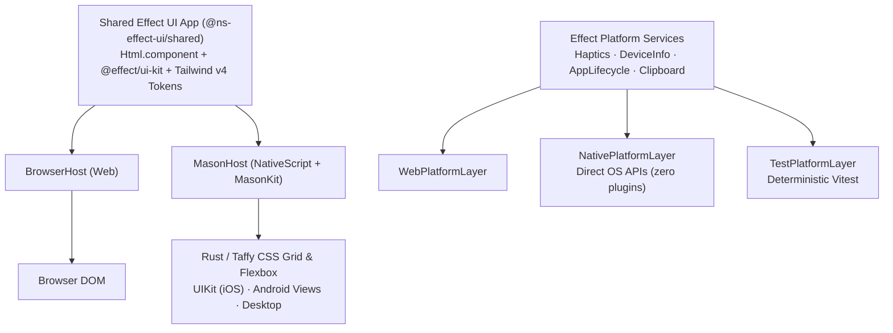

# `@nstudio/nativescript-effect-ui`

First-class **NativeScript 9.1** & **MasonKit** rendering hosts, native element vocabulary, and platform Effect `Layer`s for **[Effect UI](https://github.com/Effect-TS/ui)** (`@effect/ui`).

Write **one** Effect UI application — with typed `Schema` models, pure `update` transitions, `Query.Service` data fetching, `Command.Service` side effects, `@effect/ui-kit` headless components, and shared Tailwind v4 styling — and run it across **Web (`BrowserHost`)**, **native iOS & Android (`MasonHost`)**, and **native macOS Desktop (`MacosHost`)** with **no WebView, no Electron, no browser DOM shim, and no third-party native bridge plugins**.

---

## What It Is

Effect UI is intentionally **host-agnostic**: its core runtime talks exclusively to a minimal public `Renderer.Host<Node>` interface. Until now, Effect UI shipped with two hosts — `BrowserHost` (web DOM) and `OpenTuiHost` (terminal UI) — with no native mobile or desktop UI host.

This repository brings Effect UI to native platforms through three layers in [`packages/effect-ui`](packages/effect-ui):

1. **`MasonHost` (`@nstudio/nativescript-effect-ui/mason`) — HTML-Compatible Native Host (Strategy B)**
   Implements `@effect/ui`'s `Renderer.Host<Node>` and `Html.Host` over [`@triniwiz/nativescript-masonkit`](https://github.com/triniwiz/nativescript-mason) (Rust/Taffy CSS Grid & Flexbox backed by real native views). Unmodified `Html.component(...)` views and `@effect/ui-kit` headless components mount directly on native UIKit and Android Views.
2. **`MacosHost` (`@nstudio/nativescript-effect-ui/macos`) — Native macOS AppKit Desktop Host**
   Implements `@effect/ui`'s `Renderer.Host<MacosNode>` and `Html.Host` directly over **`@nativescript/macos-node-api`** (AppKit `NSWindow`, `NSScrollView`, `NSView`, `NSTextField`, `NSPanel` sheets, `NSHapticFeedbackManager`, `NSPasteboard`). Mounts the exact same `PulseApp` `Html.component(...)` on macOS desktop with **zero WebView, zero Electron, and zero Xcode build** (`pnpm macos`).
3. **`Native` Vocabulary & `NativeHost` (`@nstudio/nativescript-effect-ui/native`) — Dedicated NativeScript Host (Strategy A)**
   Modeled on `@effect/ui-opentui`: a strongly-typed NativeScript core vocabulary (`Native.component(...)` with `stackLayout`, `gridLayout`, `flexboxLayout`, `scrollView`, `label`, `button`, `switch`, `slider`, `progress`, `textField`, etc.) plus `NativeCommand` ref commands (`focus`, `blur`, `measure`, `animate`).
3. **Platform Effect Services (`@nstudio/nativescript-effect-ui/platform` & `@nstudio/nativescript-effect-ui/platform/native`)**
   Host-agnostic Effect `Context.Service` definitions (`Haptics`, `DeviceInfo`, `AppLifecycle`, `Clipboard`) with zero platform imports in shared code, backed by:
   - `NativePlatformLayer` — direct iOS (`UIImpactFeedbackGenerator`, `UIPasteboard`, etc.) & Android (`VibrationEffect`, `ClipboardManager`, etc.) SDK calls with zero native wrapper plugins.
   - `WebPlatformLayer` — browser equivalents (`navigator.vibrate`, `navigator.clipboard`, `matchMedia`).
   - `makeTestPlatformLayer` — deterministic in-memory recordings for Node Vitest suites.
4. **Pure-TypeScript Native Capability Subpaths (zero Swift/Kotlin/C++ bridge plugins)**
   - **`@nstudio/nativescript-effect-ui/motion`** — UI-thread native animations via iOS CoreAnimation (`UIView.animateWithDurationDelayUsingSpringWithDamping...`) and Android `ViewPropertyAnimator` RenderThread springs (`NativeMotion.track` Mount + `NativeMotion.animateTo` ref Command) — keeps running at 60/120fps even when JS is stalled, with zero Reanimated/worklets.
   - **`@nstudio/nativescript-effect-ui/sheet`** — Native OS bottom sheets (`UISheetPresentationController` medium/large detents, grabber, and iOS 26+ Liquid Glass passthrough on iOS; bottom-docked Material sheet on Android) via `<dialog data-presentation="sheet">` or `NativeSheet.presentNativeSheet(...)` / `OpenSheet` Command.
   - **`@nstudio/nativescript-effect-ui/list`** — Host-agnostic slot-recycled `VirtualList` windowing engine (`init`, `scrolled`, `measureHeight`, `computeWindow`) rendering 1,000+ rows with a tiny constant pool of recycled native views and zero re-renders on unchanged windows.
   - **`@nstudio/nativescript-effect-ui/keyboard`** — Direct native IME `Subscription` (`NSNotificationCenter` keyboard frame notifications on iOS; `WindowInsetsCompat.Type.ime()` on Android), `DismissKeyboard` Command, and `dockedComposerStyle` helper.
   - **`@nstudio/nativescript-effect-ui/crash`** — Drop-in `makeHtmlCrashFallback` & `makeNativeCrashFallback` recovery boundaries with Effect `Cause` formatting, one-tap native clipboard copy, and instant restart.
   - **`@nstudio/nativescript-effect-ui/devtools`** — `NativeDevTools.makeBridge` wrapping `@effect/ui`'s `MessageLog.makeEncoded` to buffer and stream Wire frames (`Hello` + `WireEntry`) over WebSocket to `@effect/ui-devtools` (auto-resolving `127.0.0.1` on iOS Simulator and `10.0.2.2` on Android Emulator).

---

## What Purpose It Serves

Most cross-platform architectures force a painful trade-off:
- **WebView wrappers (Capacitor / Cordova / Electron):** Share HTML/CSS, but carry a full browser engine, higher memory overhead, and async JSON bridges to native APIs.
- **Native-only custom vocabularies (OpenTUI / React Native primitives):** Share application state, but force you to rewrite views, styling, and layouts separately from the web — and write C++/Swift/Kotlin bridge modules for every native SDK.

Pairing **Effect UI + NativeScript + MasonKit** eliminates both trade-offs:

| Technology | Responsibility |
|---|---|
| **Effect UI (`@effect/ui`)** | Application architecture, `Schema` models, pure reducers, `Query` caching, `Command`/`Subscription` orchestration, deterministic `Play` testing |
| **MasonKit + Rust/Taffy** | Real CSS Grid, Flexbox, block/inline flow, HTML-shaped elements (`div`, `section`, `button`, `input`, `dialog`, `p`, `span`, …) on native views |
| **NativeScript 9.1** | Direct native execution, UIKit/Android/Desktop view hosting, and unrestricted zero-bridge access to 100% of platform SDKs |
| **Effect `Layer`s** | Composable, type-checked dependency injection swapping Web, Native, and deterministic Test implementations cleanly |

The result moves Effect UI beyond being merely *host-agnostic* to being genuinely **view-portable** across web and native — while still letting you drop into 100% native controls and OS APIs at any level of the tree.

---

## How It Works



### Under the Hood of `MasonHost`

- **Exact `Renderer.Host<MasonNode>` contract ([`MasonHost.ts`](packages/effect-ui/src/mason/MasonHost.ts)):** Implements `createElement`, `createText`, `setText`, `setAttr`, `setProp`, `insertBefore`, `remove`, `removeChildren`, `parentOf`, `nextOf`, `setEvents`, `createContainer` (for `h.keepAlive`), `commit`, and `head` (updating the native `ActionBar` title reactively from `Head.title(...)`).
- **Block-backed HTML elements ([`elements.ts`](packages/effect-ui/src/mason/elements.ts)):** Maps semantic HTML tags to MasonKit views (`Div`, `Section`, `P`, `Span`, `Input`, `TextArea`, `Img`, `Details`, `Summary`, etc.) and backs interactive/layout-bearing tags (`button`, `a`, `li`, `label`, `h1`–`h6`, `dialog`, tables) with `CSSType(tag)` subclasses of MasonKit's `Div`. That allows mixed flex layouts and child elements (such as `@effect/ui-kit`'s `Switch` rendering a `<span>` thumb inside `<button role="switch">`) while preserving CSS tag selectors.
- **Live native text updates:** `MasonTextNodeImpl` exposes a prototype `data` getter/setter (`nodeType: 3`), which MasonKit's `_installTextNodeProxy` hooks automatically so Effect UI's `setText` calls (including async `Query.Service` resolutions) update native text nodes in place without rebuilding subtrees.
- **Logical tree + native `<dialog>` elevation ([`dialog.ts`](packages/effect-ui/src/mason/dialog.ts)):** Maintains deterministic `parentOf`/`nextOf` links while elevating `<dialog>` elements out of inline layout into NativeScript's native `showModal(...)` window stack — complete with transparent backdrop scrims, `.ns-dark`/`.ns-light` theme inheritance, and backdrop tap / Android back-button -> Effect UI `cancel` event dispatch.
- **Innermost-handler events & controlled inputs ([`events.ts`](packages/effect-ui/src/mason/events.ts)):** Stores Effect UI event handlers as data (re-renders never detach/re-attach native listeners), delivers plain-data payloads matching `Html.Events`, collects `<form>` field values on `<button type="submit">` clicks, suppresses echo on controlled `value`/`checked` writes, and reverts rejected edits on the next microtask.
- **Zero-patch Tailwind v4 + MasonKit CSS pipeline ([`apps/native/vite.config.mts`](apps/native/vite.config.mts)):** Uses a `post`-phase Vite PostCSS stash/restore pass around `@nativescript/tailwind` so standard Tailwind v4 utilities (`grid`, `grid-cols-3`, `flex`, `flex-row`, `gap-3`, `gap-4`, `max-w-md`, etc.) pass straight through to MasonKit's Rust/Taffy layout engine with DIP units — without patching `node_modules`.

### Example: One Shared Component, Multiple Hosts

```ts
// packages/shared-app/src/components/App.ts (ZERO platform imports)
export const PulseApp = Html.component({
  name: 'PulseApp',
  model: PulseModel,
  message: PulseMessage,
  queries: {
    snapshot: {
      query: FetchPulseSnapshot,
      args: ({ model }) => ({ cycle: model.syncCycle }),
    },
  },
}).make({
  /* init, head, update (triggering Haptics Command), view (Html + @effect/ui-kit Switch + <dialog>) */
});
```

**On Web (`apps/web/src/main.ts`):**
```ts
const AppLayer = SharedDomainLayer.pipe(Layer.provideMerge(WebPlatformLayer));
Effect.runFork(Layer.launch(BrowserHost.mount(PulseApp, {}, document.getElementById('app')!).pipe(Layer.provide(AppLayer))));
```

**On NativeScript iOS / Android (`apps/native/src/main.ts`):**
```ts
const AppLayer = SharedDomainLayer.pipe(Layer.provideMerge(NativePlatformLayer));
Effect.runFork(Layer.launch(MasonHost.mount(PulseApp, {}, masonRoot).pipe(Layer.provide(AppLayer))));
```

**In Node Vitest (`packages/shared-app/src/components/App.test.ts`):**
```ts
const play = yield* Play.make(PulseApp, {});
yield* play.click(Locator.attr('id', 'filter-active'));
yield* play.click(Locator.attr('id', 'new-task-btn'));
// Asserts UI state, async Query results, AND exact Haptics Layer calls!
```

---

## What Else This Can Do — Across Mobile, Desktop & Beyond

Because **both NativeScript and MasonKit target far more than iOS and Android** — including **macOS**, **Windows (WinUI / DirectWrite)**, **Linux (GTK)**, and **visionOS** — this same architecture opens up an unusually broad surface area from one Effect UI codebase:

| Target / Capability | What NativeScript + MasonKit + Effect UI Unlocks |
|---|---|
| **macOS Desktop (AppKit / Mac Catalyst)** | Run the exact same `MasonHost` Effect UI app natively on macOS without Electron — with native menu bars, Touch ID / Keychain, multi-window (`Application.openWindow` in NativeScript 9.1), and tiny memory footprint. |
| **Windows Desktop (WinUI 3 / NativeScript Windows)** | MasonKit already ships a native Windows backend (`@triniwiz/nativescript-masonkit` includes `index.windows.js` + native Taffy layout). Same `Html.component` + Tailwind CSS + Effect `Layer`s for Windows Hello, native file pickers, and system tray. |
| **Linux Desktop (GTK / NativeScript Linux)** | MasonKit already ships a native Linux backend (`index.linux.js`), enabling a single Effect UI codebase to target Web, iOS, Android, macOS, Windows, and Linux — true 6-platform native reach. |
| **visionOS (Spatial Computing)** | NativeScript supports visionOS runtimes with native glass materials and spatial windows alongside the same Effect state & service architecture. |
| **First-Class Native Effect Service Ecosystem** | Build a reusable library of typed Effect `Context.Service` + `Layer` modules powered directly by NativeScript (zero C++/Swift/Kotlin bridge boilerplate): `Biometrics` (Face ID / Touch ID / Android BiometricPrompt / Windows Hello), `SecureStorage` (Keychain / Android Keystore), `Location` (CoreLocation / Android Location), `Camera`, `Bluetooth` (CoreBluetooth / BLE), `SQLite`, `Notifications`, `NativeWindow` (iPadOS / desktop multi-window), and `Widgets` / iOS Live Activities. |
| **Native Parity for `@effect/ui-kit` (41 Headless Components)** | Progressively back complex `@effect/ui-kit` components with native platform primitives where appropriate: native bottom sheets for `Drawer`, native popovers for `Popover`/`Menu`/`Select`, native recycled collection views for `VirtualList`, and native accessibility/focus routing. |
| **Real-Time 3D, GPU & Native Media** | Mix `MasonHost` UI overlays directly with NativeScript `SceneKit` / `Metal` / `Canvas` / WebGPU views driven by Effect Subscriptions and `HtmlSubscription.AnimationFrames` (60/120fps `CADisplayLink` / `Choreographer`). |
| **AI-Native DevTools & MCP Loop** | Combine Effect UI's Schema-encoded state, explicit tagged messages, deterministic `Play` tests, and `@effect/ui-devtools` MCP server with `@nativescript/vite` HMR — allowing coding agents to inspect state, dispatch messages, verify Effects, and hot-reload native mobile & desktop apps in real time. |
| **NativeScript `--compiled` Horizon** | Effect UI's strict separation of `Schema` models, tagged messages, pure reducers, Commands, and declarative views provides clean, analyzable structure for longer-term compilation experiments targeting Swift / Kotlin. |

---

## Comparing Approaches: NativeScript vs. React Native Fabric

[`goetzrobin/foldkit-native`](https://github.com/goetzrobin/foldkit-native) (`packages/effect-ui-native`) is another thoughtful community exploration running Effect UI on native mobile views without React's reconciler, using `@ng-native/fabric` over React Native Fabric and Expo. For anyone curious how different native host architectures compare, here is a side-by-side overview of the two approaches:

| Dimension | `@nstudio/nativescript-effect-ui` (NativeScript + MasonKit) | `foldkit-native` (`@ng-native/fabric` + RN Fabric / Expo) |
|---|---|---|
| **Rendering Stack** | NativeScript + MasonKit (Rust/Taffy) hosting UIKit, Android Views, AppKit, WinUI/WinRT, and GTK4 directly. No React, Metro, or Expo runtime. | React Native Fabric (C++ / Yoga) driven through `@ng-native/fabric` inside an Expo / Metro app (skips React's reconciler while reusing RN Fabric views). |
| **View Model (Web and Native)** | Supports both `MasonHost` (unmodified `Html.component(...)` markup and `@effect/ui-kit` headless components) and `NativeHost` (typed NativeScript widget vocabulary). | Uses a dedicated RN-shaped vocabulary (`h.view`, `h.text`, `h.pressable`, `h.scrollView`), keeping domain logic shared while authoring native views separately. |
| **Layout & Styling** | Rust / Taffy supporting CSS Grid (`grid-cols-*`, `gap-*`), Flexbox, block/inline flow, standard Tailwind v4, and `<dialog>` mapped to native modals/sheets. | Yoga Flexbox layout with RN style objects and `@ng-native/fabric`'s CSS subset. |
| **Native OS API Access** | Direct from TypeScript via generated native `.d.ts` typings (`UIImpactFeedbackGenerator`, `VibrationEffect`, `CoreLocation`, `SceneKit`, WinRT, GTK4) with no bridge modules. | Uses the Expo / React Native native module ecosystem (`expo-haptics`, `expo-clipboard`, `expo-audio`, or custom Swift/Kotlin Expo Modules). |
| **Bundler & JS Engine** | Vite (`@nativescript/vite`) + V8 (mobile/desktop runtimes) or Node-API (Node/Bun/Deno on desktop). | Metro + Hermes. |
| **Platform Reach** | Web, iOS, Android, macOS, Windows, and Linux. | iOS and Android (React Native / Expo). |
| **UI-Thread Motion** | CoreAnimation (iOS) and `ViewPropertyAnimator` (Android) driven from TypeScript (`@nstudio/nativescript-effect-ui/motion`). | `Motion.animate` built on `react-native-worklets` and `react-native-reanimated`. |
| **Native Mobile Primitives** | Pure-TypeScript subpaths for detent sheets (`/sheet`), recycled virtual lists (`/list`), IME keyboard subscriptions (`/keyboard`), crash recovery (`/crash`), and devtools Wire bridge (`/devtools`). | Includes mobile-focused primitives such as `VirtualList`, `AnchoredList` for streaming chat transcripts, `KeyboardBar`, `react-native-screens` navigation/sheets, `NativeCrash`, and `NativeDevTools`. |

### Different Trade-offs

- **Where `foldkit-native` (`@ng-native/fabric`) is a natural fit:** Apps already anchored in the Expo / React Native ecosystem that want to reuse specialized RN native views (such as `react-native-enriched-markdown`, `expo-audio`, or `@shopify/react-native-skia`), or mobile-focused teams adopting its `AnchoredList` streaming-chat patterns and simulated-phone test suite.
- **Where `@nstudio/nativescript-effect-ui` is a natural fit:** Teams that want to share `Html.component(...)` views, Tailwind CSS Grid layouts, and `@effect/ui-kit` headless components directly across web and native, prefer calling OS SDKs straight from TypeScript without authoring Swift/Kotlin/C++ bridge modules, or want one Effect UI host architecture extending to macOS, Windows, and Linux alongside iOS and Android.

---

## Workspace Layout

```text
ns-effect-ui/
├── packages/
│   ├── effect-ui/                # @nstudio/nativescript-effect-ui
│   │   └── src/
│   │       ├── mason/            # Strategy B: MasonHost, elements, styles, events, native <dialog>/sheet, services, tests
│   │       ├── desktop/          # Shared desktop HTML services, color/text helpers for macOS, Windows, and Linux
│   │       ├── macos/            # Native macOS AppKit host (MacosHost, MacosPlatformLayer, layout, monochrome styles)
│   │       ├── windows/          # Native Windows host (WindowsHost for WinUI 3 / XAML Islands / Composition, WindowsPlatformLayer)
│   │       ├── linux/            # Native Linux GTK4 host (LinuxHost, LinuxPlatformLayer)
│   │       ├── native/           # Strategy A: Native.component vocabulary, NativeHost, NativeCommand
│   │       ├── platform/         # Effect Services (Haptics, DeviceInfo, AppLifecycle, Clipboard) + Web/Native/Test Layers
│   │       ├── motion/           # UI-thread CoreAnimation (iOS) & RenderThread ViewPropertyAnimator (Android)
│   │       ├── sheet/            # Native UISheetPresentationController (iOS 26+ Liquid Glass) & Android bottom sheet
│   │       ├── list/             # 1,000+ row slot-recycled VirtualList windowing engine
│   │       ├── keyboard/         # Direct iOS NSNotificationCenter & Android WindowInsetsCompat IME Subscription
│   │       ├── crash/            # Interactive CrashReport & fallback recovery boundary for MasonHost / NativeHost
│   │       ├── devtools/         # MessageLog Wire encoding & WebSocket bridge for @effect/ui-devtools
│   │       └── testing/          # MockMasonHost for fast Node Vitest verification
│   └── shared-app/               # @ns-effect-ui/shared ("Effect Pulse", 100% shared app + CSS + Play tests)
└── apps/
    ├── web/                      # Vite 8 + Tailwind v4 web app (BrowserHost.mount)
    ├── native/                   # NativeScript 9.1 + @nativescript/vite + MasonKit app (iOS, Android, Windows, Linux)
    ├── macos/                    # Native macOS AppKit desktop app (@nativescript/macos-node-api + MacosHost.run)
    ├── windows/                  # Native Windows desktop app (@nativescript/windows / windows-napi + WindowsHost.run)
    └── linux/                    # Native Linux GTK4 desktop app (@nativescript/linux / linux-napi + LinuxHost.run)
```

---

## Quick Start

```bash
pnpm install

# Type-check all 7 workspaces (strict + exactOptionalPropertyTypes)
pnpm check

# Run host unit tests + portable Effect UI Play tests in Node Vitest (18 specs)
pnpm test

# Run the Web app (BrowserHost)
pnpm dev:web

# Build the Web production bundle
pnpm build:web

# Run the NativeScript iOS / Android app (MasonHost + NativeHost)
pnpm ios
pnpm android

# Run the native desktop apps (macOS AppKit, Windows WinUI/WinRT, Linux GTK4)
pnpm macos
pnpm windows
pnpm linux
```

---

## Requirements

- **Node.js** 22+ and **pnpm** 10+
- **TypeScript** with `strict: true` and `exactOptionalPropertyTypes: true` (required by `@effect/ui`)
- **NativeScript CLI** (`npm i -g nativescript`) + Xcode (for iOS/macOS) or Android SDK (for Android) to run the native app
