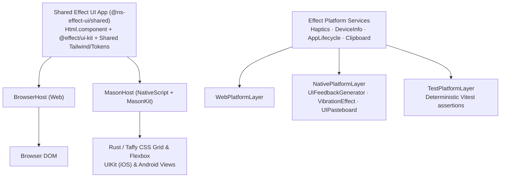

# `@nativescript/effect-ui`

Host-agnostic **[Effect UI](https://github.com/Effect-TS/ui)** on **NativeScript 9.1** & **MasonKit** — one Effect UI application across **Web**, **iOS**, and **Android** without a DOM or WebView on mobile.

## Architecture



## Two Complementary Strategies

1. **Strategy B — `MasonHost` (`@nativescript/effect-ui/mason`)**:
   Implements `@effect/ui`'s public `Renderer.Host<Node>` and `Html.Host` over `@triniwiz/nativescript-masonkit`. Mounts unmodified `Html.component(...)` views and `@effect/ui-kit` headless components (such as `Switch`) directly onto native iOS & Android views with Rust/Taffy CSS Grid/Flexbox, controlled inputs, form submission, `h.keepAlive`, and native `<dialog>` presentation via NativeScript `showModal`.
2. **Strategy A — `Native` Vocabulary & `NativeHost` (`@nativescript/effect-ui/native`)**:
   Modeled on `@effect/ui-opentui`: a dedicated, strongly-typed NativeScript element vocabulary (`Native.component(...)` with `stackLayout`, `gridLayout`, `label`, `button`, `switch`, `slider`, `progress`, `textField`, etc.) plus `NativeCommand` ref commands.
3. **Platform Effect Services (`@nativescript/effect-ui/platform`)**:
   Pure Effect `Context.Service` definitions (`Haptics`, `DeviceInfo`, `AppLifecycle`, `Clipboard`) with zero platform imports, paired with `WebPlatformLayer`, `NativePlatformLayer` (`@nativescript/effect-ui/platform/native` — direct iOS `UIFeedbackGenerator`/`UIPasteboard` and Android `VibrationEffect`/`ClipboardManager`, zero third-party plugins), and `makeTestPlatformLayer` for deterministic tests.

## Workspace Layout

```text
ns-effect-ui/
├── packages/
│   ├── effect-ui/          # @nativescript/effect-ui (MasonHost, NativeHost, Platform Services, MockMasonHost)
│   └── shared-app/         # @ns-effect-ui/shared ("Effect Pulse" — 100% shared app + Play tests)
└── apps/
    ├── web/                # Vite + Tailwind v4 web host (BrowserHost.mount)
    └── native/             # NativeScript 9.1 + @nativescript/vite + MasonKit iOS/Android host
```

## Quick Start

```bash
pnpm install

# Type-check all 4 workspaces (strict + exactOptionalPropertyTypes)
pnpm check

# Run MasonHost unit tests + shared Effect UI Play tests in Node Vitest
pnpm test

# Run the Web app (BrowserHost)
pnpm dev:web

# Run the NativeScript iOS app (MasonHost + NativeHost)
pnpm ios

# Run the NativeScript Android app (MasonHost + NativeHost)
pnpm android
```
